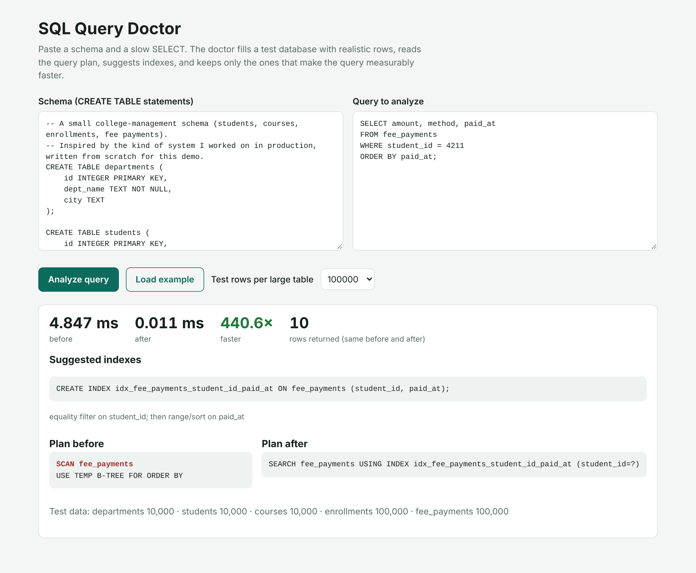

# SQL Query Doctor

Paste a database schema and a slow `SELECT`. SQL Query Doctor fills a test database with realistic rows, reads the query plan, suggests indexes, and **keeps only the indexes that make the query measurably faster**.



I built this because of a problem I solved in production. As a .NET developer on a government college-management platform, I cut data-retrieval time by about 30% by finding slow queries and adding the right indexes. That work was mostly manual: read the plan, guess an index, measure, repeat. This tool does that loop for you.

## What it does

1. **Builds test data.** It creates your schema in an in-memory SQLite database and generates rows that behave like real data: foreign keys point at real parent rows, columns like `status` repeat a few skewed values, dates spread over three years.
2. **Times the query** (median of several runs) and reads `EXPLAIN QUERY PLAN` to find full table scans and temporary sort trees.
3. **Suggests indexes** from the `WHERE`, `JOIN ... ON`, `ORDER BY` and `GROUP BY` clauses. Equality columns go first, then one range column, then sort columns, which is the order a B-tree index can actually use.
4. **Verifies each suggestion.** It creates the index, re-times the query, and drops any index that is not at least 10% faster. Indexes cost writes and disk space, so a useless one is a bug.
5. **Checks correctness.** It confirms the query returns the same number of rows before and after.

## Results on the example schema

200,000 rows in the large tables, on my laptop (your timings will differ):

| Query | Before | After | Speedup | Index kept |
|---|---|---|---|---|
| Pending fees, one category, newest first (2-table join) | 16.46 ms | 9.502 ms | 1.7x | `idx_fee_payments_status_paid_at ON fee_payments (status, paid_at)` |
| Fee history for one student | 9.10 ms | 0.004 ms | 2274.0x | `idx_fee_payments_student_id_paid_at ON fee_payments (student_id, paid_at)` |
| Course roster (2-table join) | 6.10 ms | 0.008 ms | 762.5x | `idx_enrollments_course_id ON enrollments (course_id)` |

For the first query it also tried an index on `students (category)` and dropped it, because SQLite starts that join from `fee_payments` and the extra index never got used. The low 1.7x is honest: `status = 'pending'` still matches thousands of rows, so an index can only help so much.

## Run it

Python 3.10+ and nothing else. It uses only the standard library (`sqlite3`, `http.server`).

```bash
git clone https://github.com/devjpatell/sql-query-doctor
cd sql-query-doctor

# Web app
python app.py              # open http://localhost:8000

# Command line
python cli.py examples/college.sql "SELECT amount FROM fee_payments WHERE student_id = 42 ORDER BY paid_at" --rows 200000

# Tests
python -m pytest -q
```

## How the code is organized

```
sqldoctor/
  analyzer.py   # parse the query, read the plan, suggest + verify indexes, time everything
  datagen.py    # realistic synthetic rows, parents before children so foreign keys are valid
app.py          # small JSON API + web page (standard library only)
cli.py          # command-line version
static/         # the web page
examples/       # sample college schema and queries
tests/          # pytest suite
```

## Limitations

- It targets SQLite. The index rules (equality, then range, then sort) carry over to SQL Server, MySQL and PostgreSQL, but their planners differ, so measure again on your real database.
- Query parsing is rule-based, not a full SQL parser. Subqueries, CTEs and expressions on columns (like `LOWER(email) = ...`) are only partly understood.
- Synthetic data is not your data. If your real values are more skewed, the best index can change.

## Next steps

- SQL Server support through `SET STATISTICS IO` and execution plans
- Suggest covering indexes when a query reads only a few columns
- Detect query patterns no index can fix (leading `%` in `LIKE`, functions on indexed columns)

## License

MIT
